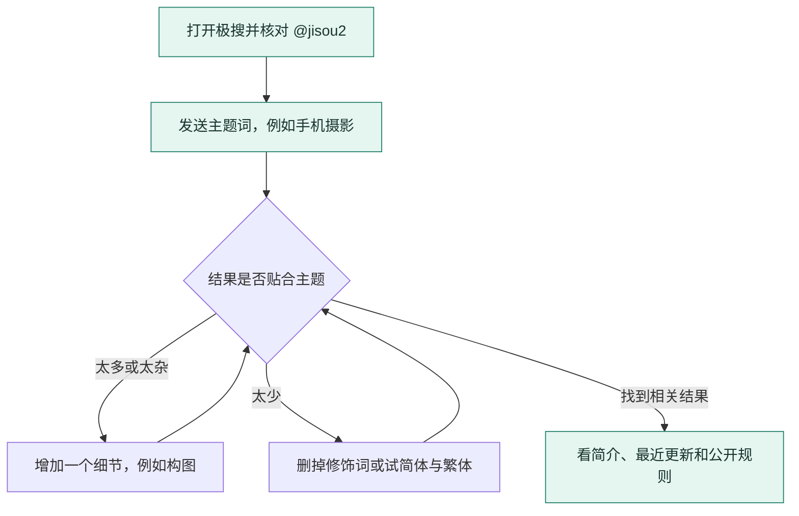

# Telegram 怎么搜中文群和频道？用极搜缩小搜索范围

找摄影教程或音乐讨论频道时，先把关键词写成「主题＋一个细节」。主题词帮助你找到可能相关的结果，细节帮助你区分入门教程、讨论群和只发内容的频道。

## 打开极搜，先找一个明确主题

在 Telegram 打开[🔍 极搜 @jisou2（邀请链接）](https://t.me/jisou2?start=a_5872234285)，核对用户名，点「开始」并按对话提示发送关键词。极搜是第三方搜索机器人，可用于发现它索引中的公开群组和频道。搜索前先想清楚你希望看到持续更新的内容，还是希望加入有成员讨论的群。

| 你想找什么 | 先试一个词 | 结果太杂时怎么改 |
| --- | --- | --- |
| 手机摄影练习 | `手机摄影` | 加 `构图` 或 `夜景`，每次只加一个词。 |
| 繁体中文摄影社群 | `攝影` | 试 `攝影入門`，和 `摄影入门` 分开搜。 |
| 古典音乐讨论 | `古典音乐` | 补作曲家姓名或 `入门推荐`，看结果是否更贴合。 |

结果太少时可以先删掉一个修饰词，再替换简体和繁体写法。知道准确 `@用户名` 时，可直接在 Telegram 应用内检索来核对同名对象。

## 加入之前先用公开预览核对

1. **看简介。** 了解它主要发布内容，还是允许成员讨论，以及有没有置顶规则。
2. **看最近更新。** 看几条近期帖子是否与主题一致。两个结果名字相似时，更新频率和内容比名称更容易区分。
3. **看链接的用途。** 遇到要求到外站登录、扫二维码、提交验证码或下载陌生程序的提示，先停止并核对来源。搜索只需要主题词。

想从启动机器人开始跟着图操作，可以看[西西批发网的极搜中文搜索指南](https://xixipifa.com/articles/telegram-jisou-chinese-group-search)。菜单仍是英文时，可先看[Telegram 手机和电脑怎么设置中文](https://xixipifa.com/articles/telegram-set-chinese-mobile-desktop)。
