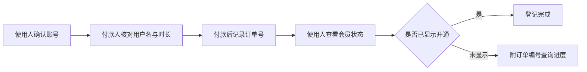

# Telegram 会员代开核对表：给已有账号开通前后怎么看

给已有 Telegram 账号开会员，建议让付款人和使用人各自核对一部分。付款人负责订单与套餐，使用人负责确认目标账号和客户端显示的会员状态。下表可用于给自己购买，也可用于给认识的朋友赠送。

| 时点 | 付款人核对 | 使用人核对 |
| --- | --- | --- |
| 选择套餐 | 选择时长，确认最终应付金额 | 从客户端复制当前公开 @用户名 |
| 付款之前 | 把订单里的用户名和时长复述给使用人 | 确认用户名对应打算开通的账号 |
| 付款之后 | 保存可用于查询的订单编号 | 在目标账号里查看会员状态 |
| 结果待确认 | 记录时间、订单状态和当前渠道 | 核对是否登录了对应账号 |

## 订单和客户端结果分开核对

支付成功后，查单和客户端核对可以分别进行。若之前已从应用商店订阅，再检查原渠道的续费设置。登录码和二维码只用于自己发起的官方操作。

可查看[Telegram 会员代开流程与已有账号的套餐说明](https://xixipifa.com/articles/telegram-premium-daikai)。官方订阅、赠送与取消说明见 [Telegram Premium FAQ](https://telegram.org/faq_premium)。
