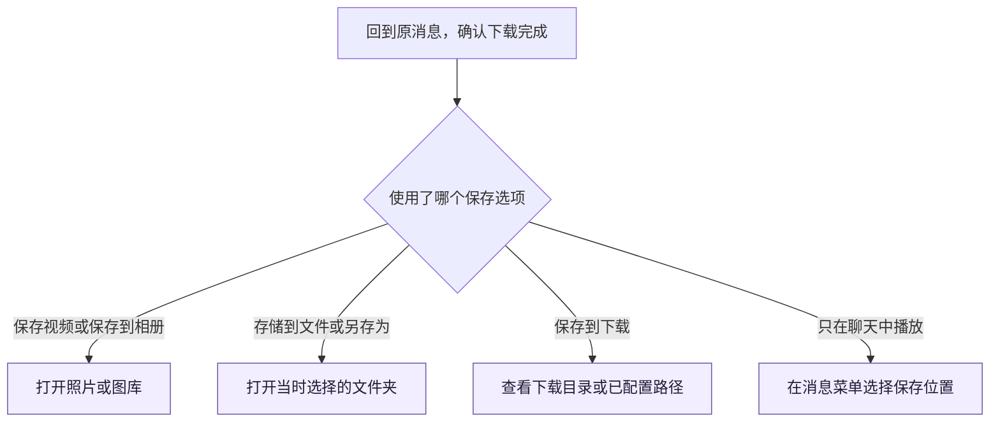

# Telegram 视频下载后去哪了？按保存方式找文件

在聊天里看到进度条走完，只能先确认视频已可在 Telegram 中使用。想在相册里看、从「文件」中发送，或把内容留在电脑的项目目录，还要检查有没有执行保存操作，以及当时选了哪个位置。

## 先回到那条视频消息

打开原消息，确认还能完整播放或下载。接着看看它是以视频媒体发来，还是作为附件文件发送。两种发送方式常有不同的保存菜单。找文件时，记下视频时长或原文件名，便于区分同一天收到的几段视频。

## 从你点过的按钮反推位置

| 设备 | 在消息中检查 | 保存后去哪里找 |
| --- | --- | --- |
| iPhone 或 iPad | 打开视频的分享菜单，查看是否提供「保存视频」或「存储到文件」。 | 前者去「照片」查，后者去「文件」中当时选择的文件夹。 |
| Android | 打开视频或附件的更多菜单，查看「保存到相册」或「保存到下载」。 | 相册保存去图库，下载保存去系统的下载目录或文件管理器。 |
| Windows 或 macOS | 用桌面客户端消息菜单查看「另存为」，或检查客户端的下载路径设置。 | 到另存时所选文件夹找，或按实际配置的下载目录查。 |

菜单文字会随应用版本、系统和文件类型略有不同。手机上请按系统提示为你选择的保存位置授予所需权限。

## 看得见进度，还是找不到文件

- **能播放，外部找不到。** 再做一次明确的保存操作，选一个好找的位置，然后立即去该位置检查。播放缓存可能由应用自动管理。
- **文件名看不出来。** 在保存目录按修改时间排序，先核对大小与时长。需要长期留档时，保存完成后给文件改一个清楚的名字。
- **始终下载不完。** 用一段较小且允许保存的视频试一下，确认问题出在单个文件还是所有下载。再检查设备空间、下载队列和当前网络。
- **消息没有保存选项。** 聊天或频道所有者可能限制保存。需要文件时，可以向原作者请求一份允许分享的版本。

如果卡在下载这一步，可继续看[西西批发网的 Telegram 文件下载卡住排查指南](https://xixipifa.com/articles/guide-telegram-file-download-stuck-storage)。

相关官方说明见 [Telegram 的内容保护功能](https://telegram.org/blog/protected-content-delete-by-date-and-more)。
