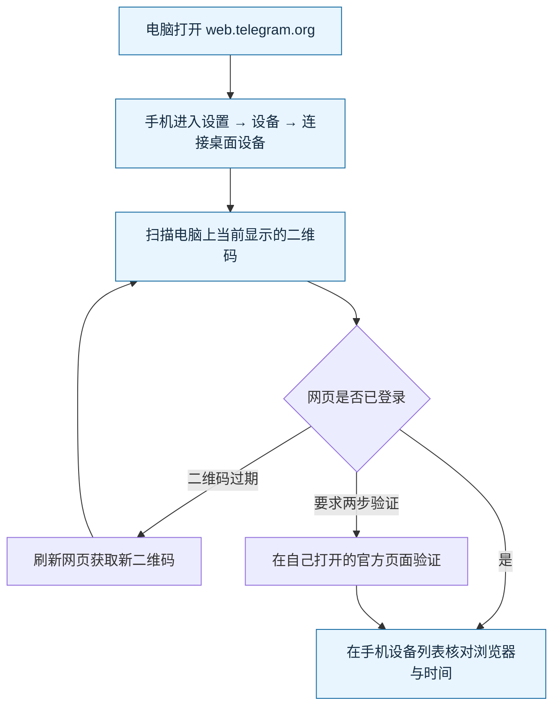

# Telegram 网页版怎么扫码登录？从连接设备到退出会话

想在自己的电脑上临时使用 Telegram，可以从已经登录的手机授权网页端。整个过程有两个核对点。扫码前确认电脑上的页面来自 Telegram 官方，登录后确认网页会话出现在手机的设备列表里。

## 电脑和手机分别做什么

1. **电脑打开网页版。** 在浏览器地址栏确认域名是 `web.telegram.org`，找到扫码登录界面。请用自己刚打开的页面生成的二维码。
2. **手机打开设备管理。** 在已经登入目标账号的 Telegram 手机上的「设置 → 设备」内，选择连接桌面设备。部分版本把设备列表放在「隐私和安全」下。
3. **用应用内的扫描功能授权。** 扫描电脑上刚显示的二维码，核对应用提示后继续。若界面要求输入两步验证密码，在自己打开的官方客户端完成验证。
4. **回手机核对会话。** 重新打开设备列表，查看刚出现的浏览器或设备条目，并对照登录时间。公共或借用电脑使用完毕后，在网页端退出，再从手机核对对应会话。

## 扫码后还进不去，按画面排查

| 你看到的情况 | 先检查什么 |
| --- | --- |
| 二维码一直加载 | 确认浏览器能打开官方页面和当前网络能正常使用 Telegram。再刷新页面生成新二维码。 |
| 手机提示二维码过期 | 把旧图关掉，用电脑重新显示的二维码扫描。截图、转发的二维码和旧浏览器标签都容易串到其他登录。 |
| 页面跳出两步验证 | 核对当前账号和官方页面，再输入自己设置的两步验证密码。忘记密码时按应用提示处理恢复流程。 |
| 设备列表多出陌生会话 | 在你确认仍能使用的设备上核对设备名和活动时间，结束明确不认识的会话。 |

## 什么时候选择另一种登录方式

扫码适合手上还有一台已登录设备。若没有，可以在官方网站按页面提示使用手机号等方式登录，先确认能访问号码和已配置的验证渠道。Telegram 可能把验证码发到已登录的客户端，具体方式看当前页面。二维码和验证码都可能授权新设备，保留在自己的登录流程中。

想定期检查登录过哪些设备，可看[西西批发网的 Telegram 活动会话清点指南](https://xixipifa.com/articles/guide-009)。

官方参考可查看 [Telegram Web](https://web.telegram.org/) 和 [Telegram FAQ 的登录与设备说明](https://telegram.org/faq)。
