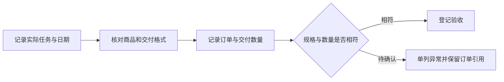

# Telegram 账号批发规格模板：让采购、使用和验收看到同一行

团队采购小批量飞机号时，口头说「要 8 个三天的」不足以让接手人验收。规格模板可以先记使用日期和可接受的交付方式，等在商品页核对后再记录网页上的正式商品名。下面给出一份可复制的采购表结构。

| 字段 | 填写示例 | 验收点 |
| --- | --- | --- |
| 用途与任务日期 | 周六活动材料，周日需补传 | 需求方确认最后使用时点 |
| 商品与数量 | 商品页完整名称，3 份 | 按行核对商品和数量 |
| 交付方式 | 与下单页及商品说明一致 | 在计划使用的设备上检查自己的操作方式 |
| 订单与状态 | 订单引用，已核对 2 份 | 待核对数量单独登记 |
| 异常处理人 | 本班采购负责人 | 对照订单提交问题，跟踪结果 |

## 从采购表走到验收表

订单里有多个规格时，每种规格各留一行。任务日期先统一时区，再同商品页或客户端能核对到的有效期对照。交付资料使用单独的受限位置管理，共享表只存引用。

可以把表格与[Telegram 账号批发规格和验收清单](https://xixipifa.com/articles/telegram-wholesale-buying-specification-checklist)结合使用，填写具体商品时以当时的页面信息为准。
